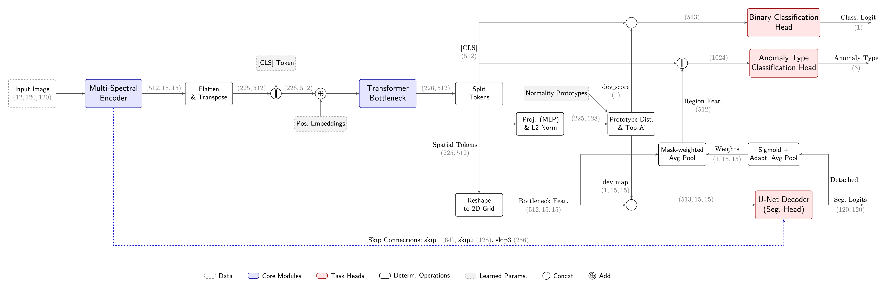
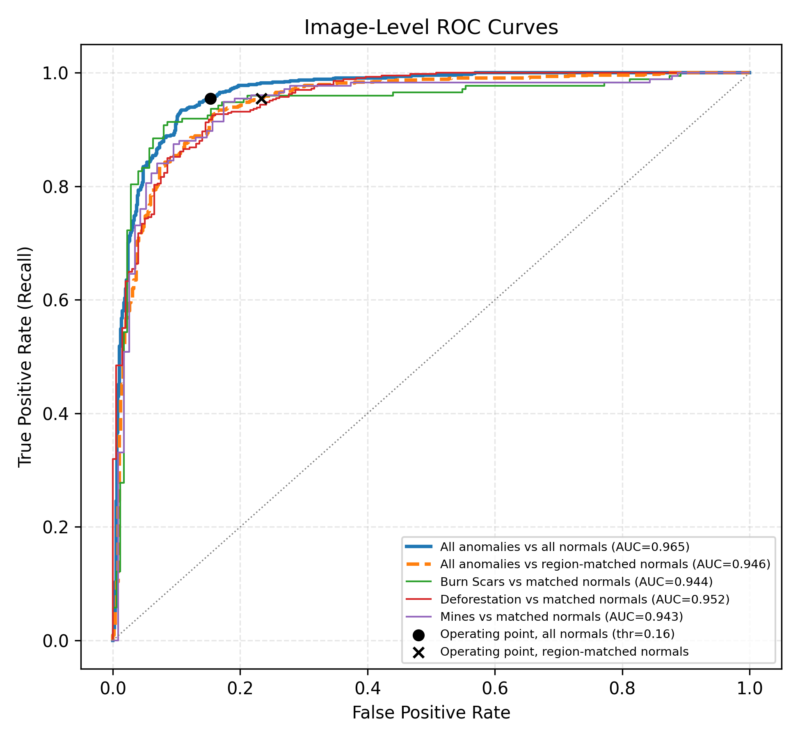
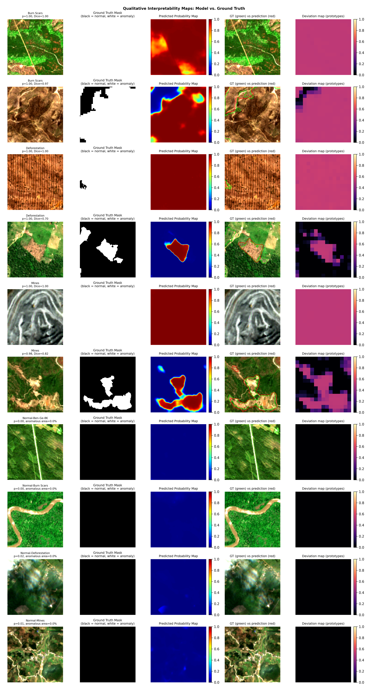

# Spectral-Spatial Anomaly Detection in Medium-Resolution Multispectral Images

Detection, localization and classification of land-surface anomalies (**burn scars**, **clear-cut deforestation**, **mining areas**) from a **single Sentinel-2 L2A image** (12 bands, 10 m/pixel), with a multi-task CNN–Transformer–U-Net network and an interpretable **normality-prototype deviation branch**.

> 📄 **Paper:** [`paper/paper.pdf`](paper/paper.pdf), *Spectral-Spatial anomaly detection in medium-resolution multispectral images*, Filippo Tatafiore, Elective in AI course, Sapienza Università di Roma, 2026.
> 💻 **Reference implementation:** [`code/code_v14/`](code/code_v14/)

---

## Table of contents

- [Overview](#overview)
- [Key results](#key-results)
- [Repository structure](#repository-structure)
- [Dataset](#dataset)
- [Method](#method)
- [Evaluation protocol](#evaluation-protocol)
- [Results](#results)
- [Getting started](#getting-started)
- [Configuration and reproducing the runs](#configuration-and-reproducing-the-runs)
- [Artifacts](#artifacts)
- [Code version history](#code-version-history)
- [Limitations](#limitations)
- [Acknowledgments and license](#acknowledgments-and-license)

---

## Overview

Most anomaly detection work in Earth observation either targets **hyperspectral** images (per-scene, unsupervised, with hundreds of narrow bands) or relies on **multi-temporal** acquisitions to detect changes. A usable pre-event image is not always available, because of irregular revisits and cloud cover.

This project does something different: from **one** 12-band Sentinel-2 L2A patch of 120 × 120 pixels (1.2 km × 1.2 km), a single forward pass answers three questions:

| Task | Question | Output |
|---|---|---|
| **Detection** (primary objective) | Is the image normal or anomalous? | image-level anomaly probability |
| **Localization** | Which pixels are anomalous? | 120 × 120 segmentation map |
| **Classification** | What kind of anomaly is it? | burn scar / deforestation / mine |
| **Interpretation** | Where does the scene depart from normality? | 15 × 15 deviation map |

Main contributions:

- **A curated dataset** of single-date Sentinel-2 L2A patches with pixel-level masks, built with Google Earth Engine from validated external products. It includes **region-matched normal images** (hard negatives) taken from the same regions and periods as the anomalies.
- **A hybrid multi-task architecture**: a Sentinel-2 pretrained ResNet-50 encoder, a Transformer bottleneck on a 15 × 15 token grid, a U-Net decoder, and MLP heads for detection and type classification.
- **A normality-prototype deviation branch**: a memory of 64 EMA-updated prototypes of normal token embeddings. The distance of each token from these prototypes gives an interpretable deviation map that feeds the detection head and the decoder.
- **Cross-Region Anomaly Transplantation (CRAT)**: a training-time augmentation that pastes real anomalies into normal images from other regions, so that the model relies less on geographic context.

## Key results

Test set: 751 normal and 773 anomalous images. Model: pretrained ResNet-50 encoder with the normality branch, `best_joint` checkpoint, 8-fold test-time augmentation.

| | Metric | Value |
|---|---|---|
| **Detection** | Image AUC-ROC (all normals / region-matched normals) | **0.965** / **0.946** |
| | Recall / precision at the recall-oriented threshold τ<sub>c</sub> = 0.164 | 0.955 / 0.864 |
| | Recall at 5 % FPR | 0.834 |
| **Localization** | Pixel AUC-ROC / AUC-PR | 0.957 / 0.874 |
| | Pooled Dice / IoU at τ<sub>s</sub> = 0.25 | **0.795** / 0.660 |
| | Per-image Dice (mean / median) | 0.707 / 0.812 |
| **Classification** | Anomaly-type accuracy / macro-F1 | 0.987 / **0.986** |
| | End-to-end 4-class macro-F1 (normal + 3 types) | 0.894 |
| **Interpretability** | Deviation map alone: pixel AUC-ROC (15 × 15 map, upsampled) | 0.953 |

Macro averages over the three anomaly types: image AUC-ROC 0.966 ± 0.003, pooled Dice 0.822 ± 0.079.

## Repository structure

```text
Spectral-Spatial-Anomaly-Detection/
├── paper/
│   ├── paper.pdf                  # Project report (method, experiments, results)
│   ├── architecture.pdf           # Architecture diagram (Figure 1 of the paper)
│   └── architecture.png           #   same diagram as PNG, shown in this README
├── build_dataset/                 # Dataset construction with Google Earth Engine
│   ├── build_dataset.ipynb        #   mines (Global ML) anomalies and normals, ben-ge-8k preprocessing, exploratory sources
│   ├── burnscars_data_retrieval.py      #   burn scars (HLS Burn Scars) anomalies + region-matched normals
│   └── deforestation_data_retrieval.py  #   deforestation (MapBiomas Alerta) anomalies + region-matched normals
├── code/
│   ├── requirements.txt
│   ├── code_v1/ … code_v13/       # Earlier iterations of the project (see "Code version history")
│   └── code_v14/                  # ★ Final implementation, used for the paper
│       ├── config.yaml            #   all hyperparameters and switches
│       ├── train.py               #   training loop, checkpointing, validation
│       ├── test.py                #   test evaluation with TTA and threshold tuning
│       ├── training_plots.py      #   plots from training_metrics.json
│       ├── eval_plots.py          #   plots from the test metrics / scores / samples
│       ├── data/dataset.py        #   datasets, augmentation, CRAT, weighted sampling
│       ├── network/
│       │   ├── trans_UNet.py      #   full model (TransUNetSentinel2) and build_model()
│       │   ├── pretrained_encoder.py  # SSL4EO-S12 ResNet-50 encoder (+ full-res stem)
│       │   ├── cnn_encoder.py     #   CNN encoder trained from scratch
│       │   ├── UNet_decoder.py    #   U-Net decoder
│       │   ├── prototypes.py      #   normality-prototype memory (EMA, re-seeding)
│       │   └── loss.py            #   multi-task, Dice, deviation losses, boundary-aware weights
│       ├── utils/
│       │   ├── globals.py         #   loads config.yaml, paths, device
│       │   └── splits.py          #   deterministic hash-based train/val/test splits
│       └── artifacts/             #   results of the v14 runs (metrics JSON, plots, samples)
├── LICENSE
└── README.md
```

The raw source datasets (`datasets/`) and the generated image folders (`Sentinel2_*`) are not tracked in git (see [`.gitignore`](.gitignore)).

## Dataset

### Sources

The anomalies are defined by validated geospatial products. Their timestamps, coordinates and polygons are used to query the Google Earth Engine collection `COPERNICUS/S2_SR_HARMONIZED` (Sentinel-2 L2A, Bottom-of-Atmosphere reflectance):

| Anomaly type | Source of locations, dates and masks |
|---|---|
| Burn scars | HLS Foundation Burnscars Dataset (contiguous US, 2018–2021) |
| Clear-cut deforestation | MapBiomas Alerta (validated deforestation alerts, Brazil) |
| Mining areas | Global ML-ready dataset for mining areas (Jasansky et al., 2024), with masks from Maus et al. (2022) and Tang & Werner (2023) |

Normal images come from two kinds of sources:

- **ben-ge-8k**: Sentinel-2 patches of structurally diverse biomes (a subset of ben-ge, an extension of BigEarthNet). These are geographically distinct, easy negatives.
- **Region-matched normals** (hard negatives): patches from the **same regions and periods** as the anomalies, so that the model has to recognize the anomaly itself and not the region. For deforestation, windows are shifted by 3–6 km from an alert, contain no alert of any date, and are acquired in the same period. For burn scars, windows come from the same HLS scenes and dates, with no burned pixel within 300 m. For mines, windows come from the same regions with no mine present.

### Processing

- All **12 L2A bands** (B1–B9, B8A, B11, B12; B10 is not distributed in L2A) and the Scene Classification Layer are exported on a common **10 m grid**. The masks are rasterized on the same grid.
- Digital numbers are divided by 10 000 to obtain reflectance, and missing values are set to 0.
- Patches with a substantial amount of SCL no-data or cloud pixels are discarded.
- Final patch shape: **(12, 120, 120)** = 1.44 km².
- During training, reflectance is clipped to [0, 1.5] and standardized per band with statistics of the training images.

### Composition

| Class | Source | Total | Test |
|---|---|---:|---:|
| Normal | ben-ge-8k | 3617 | 262 |
| | burn-scar regions | 800 | 175 |
| | deforestation regions | 2000 | 199 |
| | mining regions | 1146 | 115 |
| Anomalous | burn scars | 795 | 173 |
| | deforestation | 2000 | 425 |
| | mines | 842 | 176 |

### On-disk layout

The final dataset `Sentinel2_sup_anomaly_detection_v3/`:

```text
Sentinel2_sup_anomaly_detection_v3/
├── normal/
│   ├── ben-ge-8k/        *.npy        (12, 120, 120) float reflectance
│   ├── burn_scars/       *.npy        region-matched normals
│   ├── deforestation/    *.npy
│   └── mines/            *.npy
└── anomaly/
    ├── burn_scars/    imgs/<name>.npy   masks/<name>_mask.npy   (120, 120) binary
    ├── deforestation/ imgs/ … masks/ …
    └── mines/         imgs/ … masks/ …
```

### Splits

[`utils/splits.py`](code/code_v14/utils/splits.py) splits the data deterministically by SHA-1 hashing of file identifiers (salt `ssad_1`):

- **Normals:** 80 / 10 / 10 (train / val / test). **Anomalies:** 60 / 20 / 20.
- Hashing is done **per group** wherever patches share acquisition conditions, to avoid leakage. ben-ge patches from the same Sentinel-2 product stay together. Burn-scar anomalies and normals cut from the same HLS tile and year always fall in the same split.

### Rebuilding the dataset

The scripts in [`build_dataset/`](build_dataset/) need:

- a Google Earth Engine account, with the project id in a `.env` file (`EAI_PROJECT_ID=...`);
- the raw source products in `datasets/`;
- the extra dependencies `earthengine-api`, `wxee`, `geopandas`, `rasterio`, `rioxarray`, `shapely`, `fiona`, `python-dotenv`, `pandas` and `scipy`.

The two `.py` scripts write to `./new_data_v3/`. The notebook also contains exploratory sections (landslides, floods) that are not part of the final dataset.

## Method

### Architecture

<p align="center">
  
</p>
<p align="center"><sub>Overview of the proposed architecture with tensor shapes (Figure 1 of the paper; vector version: <a href="paper/architecture.pdf"><code>paper/architecture.pdf</code></a>).</sub></p>

- **Encoder** ([`pretrained_encoder.py`](code/code_v14/network/pretrained_encoder.py)): a ResNet-50 initialized with SSL4EO-S12 SoftCon Sentinel-2 weights. The B10 input channel is dropped from `conv1`, and the weights are downloaded automatically on the first run. The input is upscaled 120 → 240 so that the stride-4 stem does not erase small anomalies. `layer4` is discarded to keep a 15 × 15 grid. A shallow stem on the raw input provides the full-resolution skip. The alternative from-scratch encoder ([`cnn_encoder.py`](code/code_v14/network/cnn_encoder.py)) has four double-conv blocks, 12 → 64 → 128 → 256 → 512 channels.
- **Transformer bottleneck:** 226 tokens (225 spatial + [CLS]), 4 layers, 8 heads, FFN 4 × 512, dropout 0.1. Self-attention stays cheap on a 15 × 15 grid.
- **Normality-prototype branch** ([`prototypes.py`](code/code_v14/network/prototypes.py)): the prototypes are **not** trained by back-propagation. At each step, every token of the normal training images is assigned to its nearest prototype, and each prototype is moved towards the mean of its tokens with step η:
  `p_k ← normalize((1 − η) p_k + η z̄_k)`. The deviation of a token is `d = 1 − max_k cos(z, p_k)`. The EMA step follows the LR schedule (full rate during warmup, then scaled by `lr / LR`). Dead prototypes are re-seeded on random normal tokens only while the LR is still high.
- **Type head:** fuses the global [CLS] token with bottleneck features pooled inside the predicted anomaly region. The segmentation probabilities are detached, so the type loss does not affect the decoder.
- About **26 M parameters**: truncated ResNet-50 ≈ 8.6 M, Transformer ≈ 12.6 M, U-Net decoder ≈ 3.9 M.

### Training objective

```text
L_tot = α·L_cls + L_seg + δ·L_type + λ·L_dev        L_seg = β·L_seg,BCE + γ·L_seg,Dice
α = β = γ = 1.0,  δ = λ = 0.5
```

| Term | Description |
|---|---|
| `L_cls` | Image-level BCE |
| `L_seg,BCE` | Pixel-wise BCE |
| `L_seg,Dice` | Soft Dice loss, computed only on images with at least one anomalous pixel |
| `L_type` | Cross-entropy on the anomaly type, computed only on anomalous images |
| `L_dev` | Margin loss on the 15 × 15 deviation map. Tokens with no anomalous pixel are pulled to deviation 0; tokens with ≥ 50 % anomalous pixels are pushed above the margin `m = 0.5`; boundary tokens are ignored |

**Boundary-aware masking** (`SEG_IGNORE_BORDER`, `SEG_IGNORE_NODATA`) gives zero weight to no-data pixels and to a band of pixels around the mask edges in the segmentation and deviation losses, because the reference polygons are coarse. At inference, no-data pixels are forced to be non-anomalous.

### Cross-Region Anomaly Transplantation (CRAT)

With probability `CRAT_PROB` (0.2 in the CRAT run), a normal training image becomes a synthetic anomalous image. A real anomaly is cut from a training image of a **different region** and pasted with its mask and type label ([`data/dataset.py`](code/code_v14/data/dataset.py)):

- **Donors** are training anomalies with partial masks covering 2–70 % of the patch. Types with fewer than 30 donors are not transplanted.
- **Region constraint:** the donor type must differ from the canvas region (ben-ge canvases accept every type).
- **Context matching:** the spectral angle between the donor background and the canvas mean spectrum must be ≤ 0.10 rad.
- **Deforestation constraints:** donors must show an NDVI drop of at least 0.05, and the canvas must be vegetated (NDVI ≥ 0.5).
- **No-data handling:** canvases with more than 5 % no-data are skipped, and no-data donor pixels are never pasted.
- **Pasting:** random rotation or flip, then a single brightness gain for all bands (clamped to [1/1.5, 1.5], so band ratios and spectral indices are preserved), then blending with 5 × 5 feathered edges.

### Optimization

| Setting | Value |
|---|---|
| Optimizer | AdamW, base LR 1e-4, pretrained backbone LR × 0.1 |
| Weight decay | 1e-4, only on conv/linear weights (not on biases or BatchNorm) |
| Schedule | 2 warmup epochs (linear from 10 %), then cosine annealing |
| Epochs / batch size | 50 / 32, mixed precision (AMP) on CUDA |
| Augmentation | random flips, 90° rotations, translations up to ±40 px (reflect padding) |
| Sampling | weighted by source (`1 / n_source^0.5`), with per-source multipliers (ben-ge ×0.5, deforestation normals ×2) |
| Input normalization | per-band mean/std computed on up to 2000 training images and stored in the checkpoint |

## Evaluation protocol

- **Checkpoints:** `train.py` saves `best_cls.pth` (best val AUC), `best_seg.pth` (best val soft Dice), `best_joint.pth`, `epoch_{10,20,30,40}.pth` and `last.pth`. The reported model maximizes the joint validation score
  `J = ½ · (AUC_matched + (1 − L_soft-Dice))`,
  which weighs detection against region-matched normals and localization equally.
- **Test-time augmentation:** predictions are averaged over the 8 dihedral transforms (4 rotations × optional flip). Segmentation and deviation maps are mapped back to the original orientation before averaging.
- **Thresholds**, both tuned on TTA validation predictions:
  - classification τ<sub>c</sub>: the highest threshold with validation recall ≥ 0.95 (recall-oriented monitoring use). The modes `f1` and `fpr` are also available.
  - segmentation τ<sub>s</sub>: grid search maximizing the mean per-image Dice on validation anomalous images.
- **Metrics**, computed pooled, per anomaly type and macro-averaged:
  - detection: AUC-ROC against all normals and against **region-matched normals** (the primary metric), Recall@5 % FPR, precision/recall/F1, FPR per normal source;
  - localization: pixel AUC-ROC/AUC-PR, IoU, Dice, per-image Dice (also on partial masks only and gated by the classifier), false-positive-region rate on normal images (≥ 20 predicted pixels);
  - classification: type accuracy, macro-F1, end-to-end 4-class confusion matrix;
  - normality branch alone: image AUC of the deviation score and pixel AUC of the deviation map.

## Results

All numbers are from the paper (Section 6). They correspond to `code/code_v14/artifacts/ssad_v14_2_results/`.

### Anomaly detection

| | Overall | Burn scars | Deforestation | Mines | Macro |
|---|---:|---:|---:|---:|---:|
| AUC-ROC (all normals) | 0.965 | 0.971 | 0.963 | 0.964 | 0.966 ± 0.003 |
| AUC-ROC (matched normals) | 0.946 | 0.944 | 0.952 | 0.943 | 0.947 ± 0.004 |
| Recall@5%FPR | 0.834 | 0.913 | 0.800 | 0.840 | 0.851 ± 0.047 |
| Recall (τ<sub>c</sub>) | 0.955 | 0.948 | 0.955 | 0.960 | 0.954 ± 0.005 |
| Precision (τ<sub>c</sub>) | 0.864† | 0.820 | 0.887 | 0.866 | 0.858 ± 0.028 |
| FPR on matched normals (τ<sub>c</sub>) | 0.233 | 0.206 | 0.261 | 0.226 | 0.231 ± 0.023 |

† against all test normals. Geographically distinct ben-ge normals are rejected almost perfectly: 1 of 262 exceeds τ<sub>c</sub>. Almost all false positives come from region-matched normals. Evaluating without them would overestimate detection quality.

<p align="center">
  
</p>

### Anomaly localization

| | Overall | Burn scars | Deforestation | Mines | Macro |
|---|---:|---:|---:|---:|---:|
| Pixel AUC-ROC | 0.957 | 0.953 | 0.962 | 0.875 | 0.930 ± 0.039 |
| Pixel AUC-PR | 0.874 | 0.979 | 0.806 | 0.886 | 0.890 ± 0.071 |
| IoU | 0.660 | 0.866 | 0.584 | 0.667 | 0.706 ± 0.118 |
| Dice | 0.795 | 0.928 | 0.738 | 0.800 | 0.822 ± 0.079 |
| Per-image Dice (mean / median) | 0.707 / 0.812 | 0.885 / 0.967 | 0.623 / 0.704 | 0.733 / 0.819 | 0.747 ± 0.107 |

Gating the segmentation with the classifier lowers the false-positive-region rate on normal images from **0.260 to 0.153**, for a one-point drop in per-image Dice (0.697). Burn scars are localized best. For mines, the model also flags adjacent bare ground (roads, cleared land) that the reference polygons exclude. Deforestation suffers from coarse boundaries and weak contrast with older clearings.

### Type classification and end-to-end performance

Type accuracy is **0.987** and macro-F1 **0.986**. All burn scars are classified correctly. End-to-end confusion matrix (an image is *normal* if p < τ<sub>c</sub>, otherwise its predicted type):

| GT \ Pred | Normal | Burn scars | Deforestation | Mines |
|---|---:|---:|---:|---:|
| **Normal** | 636 | 33 | 56 | 27 |
| **Burn scars** | 9 | 164 | 0 | 0 |
| **Deforestation** | 19 | 0 | 401 | 5 |
| **Mines** | 7 | 0 | 2 | 166 |

151 of the 158 end-to-end errors (96 %) are **detection** errors, mostly false alarms on region-matched normals. The 4-class end-to-end macro-F1 is 0.894.

### Interpretability

Used alone, without the supervised heads, the normality branch detects anomalies with an image AUC-ROC of **0.940** against all normals and **0.910** against matched normals. Its 15 × 15 deviation map ranks anomalous pixels with an AUC-ROC of **0.953**, close to the full-resolution segmentation head (0.957) at 64× lower resolution. The deviation maps follow the shape of the anomalies and agree with the segmentation head on both correct and incorrect predictions.

<details>
<summary><b>Qualitative results</b> (RGB · ground truth · predicted probability · overlay · deviation map)</summary>
<p align="center">
  
</p>
For each anomaly type: the image with the best and the median per-image Dice. Last four rows: one normal image per source.
</details>

### Ablations

| Model | AUC | AUC<sub>m</sub> | Rec<sub>img</sub> | FPR<sub>m</sub> | AUC-PR | Dice | Dice<sub>img</sub> | FP-reg. | Type F1 | E2E F1 |
|---|---:|---:|---:|---:|---:|---:|---:|---:|---:|---:|
| Scratch CNN encoder (`v14_0`) | 0.965 | 0.947 | 0.948 | 0.225 | 0.864 | 0.775 | 0.683 | 0.148 | 0.973 | 0.889 |
| **Baseline** (`v14_2`) | 0.965 | 0.946 | 0.955 | 0.233 | 0.874 | 0.795 | 0.707 | 0.153 | 0.986 | 0.894 |
| Baseline + CRAT (`v14_3`) | 0.958 | 0.943 | 0.937 | 0.192 | 0.858 | 0.796 | 0.701 | 0.133 | 0.979 | 0.893 |

Subscript *m*: against region-matched normals. FP-reg.: gated false-positive-region rate on normal images.

- **Pretrained encoder:** better localization (+2.0 pooled Dice, +2.4 per-image Dice) and type F1, with similar detection. It also converges faster: val AUC passes 0.96 after about 10 epochs.
- **CRAT:** lowers the FPR on matched normals (0.233 → 0.192) and the reliance on regional context. The fraction of region-matched normals assigned to *their own region's* anomaly type drops from 76.3 % to 65.2 % (chance level: 33.3 %). Detection drops slightly (AUC 0.958, recall 0.937).

## Getting started

### 1. Install

Python 3 with PyTorch is required (a CUDA GPU is recommended; AMP is used automatically on CUDA).

```bash
pip install -r code/requirements.txt
```

`requirements.txt` lists `torch`, `numpy`, `scikit-learn`, `pyyaml`, `matplotlib`, `tqdm`, `timm` and `scipy`. Install a CUDA build of PyTorch from [pytorch.org](https://pytorch.org) if needed. The first training run downloads the SSL4EO-S12 ResNet-50 weights from Hugging Face.

### 2. Point the code to the dataset

The dataset location is read from the `SSAD_DATA_ROOT` environment variable. If the variable is not set, `dataset_path` in `config.yaml` is resolved relative to the `code/` folder. The simplest option is to set the variable:

```bash
export SSAD_DATA_ROOT=/absolute/path/to/Sentinel2_sup_anomaly_detection_v3
```

### 3. Train

All scripts import modules relative to the `code_v14/` folder, so run them from there:

```bash
cd code/code_v14
python -m utils.splits     # optional: split sizes and split fingerprint
python train.py
```

`train.py` writes the checkpoints (`best_cls.pth`, `best_seg.pth`, `best_joint.pth`, `epoch_XX.pth`, `last.pth`) to `code_v14/artifacts/`. It updates `artifacts/<MODEL_VERSION>_<MODEL_RUN>_results/training_metrics.json` after every epoch.

### 4. Evaluate

```bash
python test.py
```

`test.py` evaluates every checkpoint found in `artifacts/`, with TTA and thresholds re-tuned on the validation set. For each checkpoint it writes to `artifacts/<MODEL_VERSION>_<MODEL_RUN>_results/`:

- `*_test_metrics.json`: overall, per-class, type and end-to-end metrics;
- `*_scores.json`: per-image probabilities, losses, Dice/IoU and deviation scores;
- `*_test_vis_samples.npz`: qualitative samples.

### 5. Plot

The plotting scripts read from the archived layout `artifacts/ssad_<version>_<run>_results/<version>_<run>_results/`, the same layout as the committed artifacts. Move the results folder there first:

```bash
mkdir -p artifacts/ssad_v14_2_results && mv artifacts/v14_2_results artifacts/ssad_v14_2_results/
python training_plots.py   # → artifacts/ssad_v14_2_results/training_plots/
python eval_plots.py       # → artifacts/ssad_v14_2_results/<MODEL_ID>_eval_plots/
```

`MODEL_VERSION`, `MODEL_RUN` and, in `eval_plots.py`, `MODEL_ID` (for example `best_joint_tta`) are constants at the top of the two plotting scripts. Edit them to plot another run or checkpoint.

## Configuration and reproducing the runs

All settings are in [`code/code_v14/config.yaml`](code/code_v14/config.yaml). The main switches are:

| Key | Meaning |
|---|---|
| `BACKBONE` | `cnn` (from scratch), `resnet50_softcon` (SSL4EO-S12 SoftCon), `resnet50_moco` (SSL4EO-S12 MoCo) |
| `INPUT_UPSCALE` | `2` to upsample 120 → 240 before the ResNet (gives the 15 × 15 grid); `1` for the CNN |
| `USE_DEV_BRANCH` | enables the normality-prototype branch |
| `NUM_PROTOTYPES`, `PROTO_DIM`, `PROTO_MOMENTUM`, `DEV_MARGIN`, `DEV_TOPK`, `DEV_LOSS_WEIGHT` | prototype memory and deviation loss (64, 128, 0.99, 0.5, 8, 0.5) |
| `TYPE_LOSS_WEIGHT` | weight δ of the type loss (0.5; 0 disables the type head) |
| `CRAT_PROB` and `CRAT_*` | Cross-Region Anomaly Transplantation and its constraints |
| `SEG_IGNORE_BORDER`, `SEG_IGNORE_NODATA` | boundary-aware and no-data-aware loss masking |
| `SOURCE_BALANCE_POWER`, `SOURCE_WEIGHT_MULT` | source-balanced sampling and hard-negative multipliers |
| `CLS_THRESHOLD_MODE`, `TARGET_RECALL`, `TARGET_FPR` | how τ<sub>c</sub> is chosen (`recall` / `f1` / `fpr`) |
| `HOLDOUT_CLASS` | open-set option: removes an anomaly type from train/val (not used in the paper) |
| `MODEL_VERSION`, `MODEL_RUN` | name of the output folder |

Settings of the v14 runs, recovered from the git history of `config.yaml`:

| Run | Paper | `BACKBONE` | `INPUT_UPSCALE` | `USE_DEV_BRANCH` | `SOURCE_WEIGHT_MULT` | `CRAT_PROB` | `SEG_IGNORE_BORDER` / `_NODATA` |
|---|---|---|---|---|---|---|---|
| `v14_0` | scratch CNN encoder (Table 5) | `cnn` | 1 | `false` | `{}` | 0.0 | 0 / `false` |
| `v14_1` | not reported | `resnet50_softcon` | 2 | `false` | `{}` | 0.0 | 0 / `false` |
| `v14_2` | **main model** (Sections 6–7) | `resnet50_softcon` | 2 | `true` | ben-ge 0.5, deforestation 2.0, mines 1.0 | 0.0 | 0 / `false` |
| `v14_3` | baseline + CRAT (Table 5) | `resnet50_softcon` | 2 | `true` | ben-ge 0.5, deforestation 2.0, mines 1.0 | 0.2 | 2 / `true` |

The committed `config.yaml` has `MODEL_RUN: "2"` and `CRAT_PROB: 0.0`, with boundary-aware masking enabled (`SEG_IGNORE_BORDER: 2`, `SEG_IGNORE_NODATA: true`). To reproduce `v14_2` exactly, set those two values to `0` / `false`. The other hyperparameters are shared by all runs: 50 epochs, batch 32, LR 1e-4, seed 0, salt `ssad_1`.

## Artifacts

[`code/code_v14/artifacts/`](code/code_v14/artifacts/) contains the outputs of the v14 runs. Model checkpoints (`.pth`) are not included.

```text
artifacts/ssad_v14_<run>_results/
├── v14_<run>_results/
│   ├── training_metrics.json                  # per-epoch losses, val AUC (all / matched), joint score, prototype stats, LR
│   ├── v14_<run>_<ckpt>_tta_test_metrics.json # test metrics of each checkpoint
│   ├── v14_<run>_<ckpt>_tta_scores.json       # per-image records
│   └── v14_<run>_<ckpt>_tta_test_vis_samples.npz
├── training_plots/                            # loss curves, components, val AUC/metrics, LR, type and deviation branches
└── <ckpt>_tta_eval_plots/                     # confusion matrices, ROC, score distributions, per-image Dice, samples …
```

`ssad_v14_2b_results/` contains the same `best_joint` evaluation as `v14_2`, with identical metrics. Only the score-distribution and qualitative plots were regenerated; these are the figures used in the paper.

## Code version history

The `code/` folder keeps every iteration of the project. Only `code_v14` is the reference implementation.

| Version | Main idea |
|---|---|
| v1–v5 | **Unsupervised** approach: a Transformer autoencoder on DCT patch features, trained on normal images only (masked-band prediction, band-group masking, multi-scale tokens, spectral-index baselines, Deep-SVDD-style compactness) |
| v6–v7 | Switch to **supervised multi-task** learning: CNN encoder, Transformer bottleneck, classification head and U-Net decoder (v7: focal / focal-Tversky losses) |
| v8 | SSL4EO-S12 pretrained ResNet-50 encoder with input upsampling |
| v9 | Reorganized dataset with region-matched normals; random-shift augmentation; per-image Dice and AUC against matched normals |
| v10–v11 | Anomaly-type head, LR warmup, gated segmentation, new threshold modes and metrics; v11 trained on dataset v2 |
| v12 | **Normality-prototype deviation branch**; LR-coupled prototype EMA, `best_joint` checkpoint, 8-fold TTA, hard-negative sampling |
| v13 | **CRAT** augmentation, coarse-label-aware losses, open-set `HOLDOUT_CLASS` |
| **v14** | Final version, trained on dataset **v3**. All results in the paper come from this version |

## Limitations

- **Reference labels:** the ground truth comes from external products. Coarse polygon boundaries and anomalies missing from the masks of normal scenes (unmapped fires, old clearings) cap the overlap metrics and inflate the false-positive rates.
- **Single date:** without a pre-event acquisition, an event can only be recognized from its appearance. This is enough for burn scars and mines, but limits deforestation, where recent and old clearings look alike.
- **Supervised:** labelled examples are needed for every anomaly type. The model targets three known types and is not an open-set detector.
- **Operating point:** recall 0.955 costs a 23.3 % FPR on hard negatives. Since anomalies are rare in monitoring, the threshold should reflect the cost of false alarms, and the gated output should be preferred.

Future work includes more anomaly types and regions, and an assessment on resource-constrained hardware.

## Acknowledgments and license

This project uses data from Copernicus Sentinel-2 (ESA), accessed through Google Earth Engine. Anomaly labels come from the HLS Foundation Burnscars dataset, MapBiomas Alerta and the Global ML-ready mining dataset; normal scenes come from ben-ge-8k. The pretrained encoder uses SSL4EO-S12 weights (Wang et al.). Each source keeps its own license.

The code is released under the [MIT License](LICENSE).
